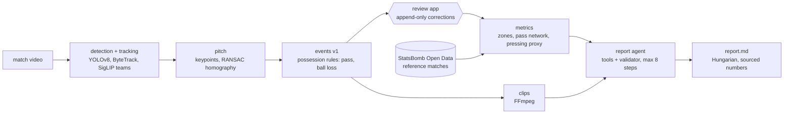

# TaktikAI

**Automatic match tagging and coaching reports from a club's own video.** Built for video
analysts at Hungarian NB I / NB II clubs, who spend hours tagging every match by hand.

TaktikAI detects players and the ball, maps them onto the pitch, finds passes and ball losses,
cuts a clip for every event and writes a short coaching report in Hungarian. **Every number is
computed by code; the language model only interprets numbers that tools return, and a validator
rejects any report that does not.**

**Live demo:** a static Hugging Face Space with tactical metrics and a validated report for the
2018 World Cup final (StatsBomb Open Data). Link: see the repository description once it is
published. To run the demo locally, see [Try it](#try-it).

## For coaches: what you get (2 minutes)

- **An event list** of passes and ball losses with time, team and pitch zone, each with a video
  clip (5 s before, 3 s after), filterable by type, team and zone.
- **A review app** (Hungarian UI) to accept, delete or correct an event with one click; your
  corrections are kept and the predictions are never overwritten.
- **Metrics:** passes and pass accuracy, ball losses per third and lane, a pressing indicator
  (PPDA-style), pass networks, and shots and expected goals where the data has them.
- **A short report** with 2-3 findings, each with the numbers behind it, the clips that show it
  and a training focus. It says plainly how much a short clip can support.

What it does not do yet: shots and set pieces from video, panning tactical-camera footage
(tested on fixed broadcast clips only), and it needs the kit colours and the direction of play
entered once per match.

## How it works (for engineers)



- **Stages are files:** each stage reads and writes `data/processed/<match>/` and can run alone;
  thresholds live in `configs/*.yaml`. Details per stage: [docs/PIPELINE.md](docs/PIPELINE.md).
- **Evaluation first:** events are measured against hand-tagged golden sets with a tagger app;
  thresholds are tuned leave-one-clip-out and the held-out number is the one reported.
- **The report agent is a plain Python loop** (no framework) over tools that return metrics,
  events and clips. The validator accepts a report only if every number appears in a tool result,
  every supporting number equals the field it names as its source, comparisons point the right
  way, the text is Hungarian, and every clip id was returned by a tool. The sample-size note is
  written by code, not by the model.
- **Local first:** the default LLM is Qwen3-8B (Apache-2.0) via Ollama, free and offline; the
  Anthropic API (Claude Haiku 5.5) is an optional backend behind an environment variable.
- **Licences are enforced, not just documented:** a test fails the build if anything derived
  from licensed footage or StatsBomb data would be committed outside the allowed places.

## Results

Events v1 on the `dfl` golden set (five 30 s broadcast clips; aggregates over the whole set):

<!-- results:events:start -->
| golden set | event type | golden events | precision | recall | F1 |
|---|---|---|---|---|---|
| dfl (5 clips) | pass | 43 | 0.889 | 0.744 | 0.810 |
| dfl (5 clips) | ball loss | 4 | 0.167 | 1.000 | 0.286 |
| dfl (5 clips) | shot | 1 | – | 0.000 | 0.000 |

Run of 2026-10-28 at commit `98e8de2-dirty`, matching tolerance 2 s. Thresholds were tuned leave-one-clip-out; for passes the held-out estimate equals this result (docs/EXPERIMENTS.md).
<!-- results:events:end -->

Report agent, local Qwen3-8B, one run per match on three matches per prompt version
(acceptance = the validator accepted the report; rubric: [docs/REPORT_RUBRIC.md](docs/REPORT_RUBRIC.md)):

<!-- results:report:start -->
| prompt version | model | runs | accepted | rubric (useful / clear / terms, 1-5) |
|---|---|---|---|---|
| report_system v1 | Qwen3-8B-GGUF:Q4_K_M | 3 | 2 | not scored yet |
| report_system v2 | Qwen3-8B-GGUF:Q4_K_M | 3 | 2 | not scored yet |
| report_system v3 | Qwen3-8B-GGUF:Q4_K_M | 3 | 1 | not scored yet |
| report_system v3.1 | Qwen3-8B-GGUF:Q4_K_M | 3 | 2 | not scored yet |
<!-- results:report:end -->

How these numbers were obtained, and the trade-off between stricter checks and acceptance:
[docs/EXPERIMENTS.md](docs/EXPERIMENTS.md).

## Try it

**The demo (about a minute, needs only Python):**

```sh
git clone https://github.com/lendvaioli/taktikai.git
cd taktikai
python -m http.server 8000 --directory space    # open http://127.0.0.1:8000
```

**The pipeline (development setup, a few minutes):** needs [uv](https://docs.astral.sh/uv/) and
GNU make; FFmpeg for clips, Ollama for reports, a GPU for full matches (Kaggle/Colab notebook in
`notebooks/`).

```sh
make install                                   # Python 3.11 environment with all extras
make test && make lint
make statsbomb COMP=43 SEASON=3 MATCH=8658     # download one StatsBomb Open Data match
make run STAGE=metrics MATCH=sb_8658           # metrics.json
make run STAGE=report MATCH=sb_8658            # report via the local LLM (Ollama + Qwen3-8B)
make run STAGE=detection VIDEO=data/raw/my_clip.mp4   # own footage: detection, then pitch,
                                                      # events, clips, metrics, report
```

## Models, data and licences

<!-- models:start -->
| model / dataset | licence | used in |
|---|---|---|
| football-player-detection.pt (YOLOv8, classes ball / goalkeeper / player / referee) | **Non-commercial use only, licence review pending.** See caveats below. | detection |
| football-players-detection (Roboflow Universe dataset the detector was trained on) | CC BY 4.0 according to search results; | detection (indirectly, via the weights) |
| DFL - Bundesliga Data Shootout (source footage of the dataset above) | Unclear: competition rules could not be read. | detection (indirectly) |
| DFL sample clips (5 x 30 s, 1080p, 25 fps), stored in `data/raw/` | Unclear, same as the DFL competition data. | detection, pitch (test input); golden set `dfl` (private) |
| google/siglip-base-patch16-224 | Apache-2.0 | tracking (team assignment) |
| football-pitch-detection.pt (YOLOv8-pose, 32 pitch keypoints) | **Non-commercial use only, licence review pending.** Same caveats as the detector weights, see below. | pitch |
| football-field-detection (Roboflow Universe dataset the keypoint model was trained on) | CC BY 4.0 according to search results; | pitch (indirectly, via the weights) |
| Qwen/Qwen3-8B-GGUF, quantisation Q4_K_M (5.03 GB), run by Ollama as `hf.co/Qwen/Qwen3-8B-GGUF:Q4_K_M` | Apache-2.0 (model card, checked 2026-10-28) | report (default LLM backend, local) |
| StatsBomb Open Data, FIFA World Cup 2018 final (competition 43, season 3, match 8658), stored in `data/raw/statsbomb/` | **Not an open licence:** StatsBomb Public Data User Agreement (LICENSE.pdf, last updated 8 September 2023). | metrics (reference data), report (demo on a full match) |
| Claude (Anthropic API), model `claude-haiku-5-5` (low-cost; changed from `claude-opus-5-5` on 2026-10-28) | Proprietary API, paid per token | report (optional backend, `TAKTIKAI_LLM_BACKEND=anthropic`; not run so far) |
| asset | terms | used in |
| --- | --- | --- |
| `space/assets/hudl-statsbomb-logo-black.png`, `hudl-statsbomb-logo-white.png` | Required by clause 1.4 of the User Agreement for any published analysis; | Space header, footer and charts |
<!-- models:end -->

Full record with sources and caveats: [docs/MODELS.md](docs/MODELS.md). In short: the code is
**AGPL-3.0-or-later** ([LICENSE](LICENSE)). The detector and pitch weights come from
roboflow/sports and are used for development only (non-commercial, licence review pending). The
DFL development clips and everything derived from them per clip stay private. StatsBomb data is
used for non-commercial analysis, published only as aggregates next to the StatsBomb logo, and
never redistributed.

## Limitations

- **Small, easy evaluation data:** 43 golden passes from five 30 s fixed-camera broadcast clips.
  Club tactical cameras pan and zoom; the pitch and tracking thresholds are unverified there.
- **Two event types:** passes and ball losses. Ball-loss precision is low (most false losses are
  brief opponent touches); shots and set pieces are not detected from video.
- **Manual match setup:** kit colours and the direction of play per half are entered by hand.
- **The pressing indicator is a proxy:** it divides by the opponent's ball losses, not by
  tackles and interceptions, so it is not comparable to published PPDA.
- **Reports from an 8B model:** about 2 of 3 runs pass the validator, and the validator cannot
  judge wording (a title can still contradict its claim). Human rubric scores are pending.
- **Detector licence:** the YOLOv8 weights are not cleared for commercial use.

## Roadmap

1. **Video demo with consented footage (phase 7b):** a recording from a club that has given
   written consent: minimap video, filterable event list with clips, report; and a Hugging Face
   dataset with the golden-set schema and annotations of that footage.
2. **Panning footage:** validate pitch and tracking thresholds; re-link fragmented tracks.
3. **Reports:** rubric scores, and a live comparison of Qwen3-8B with Claude Haiku 5.5.
4. **Events:** shots and set pieces; a separate hold time before a ball loss.
5. **Licence-clean detector:** replace the roboflow/sports weights before any commercial use.

Open items with their reasons: [docs/TODO.md](docs/TODO.md).

## Lessons from building with Claude Code

TaktikAI was built with Claude Code as a pair programmer, under a `CLAUDE.md` that sets the rules:
plan first and wait for approval, numbers come from code, every stage is a file, record every
licence and stop when one is unclear. What that taught:

- **Plan-then-approve gates paid off.** Every phase started with a written plan (files, schemas,
  tests) that was corrected before any code. Most course changes were cheap because they
  happened there: deferring shots, splitting the demo into a StatsBomb part and a consented
  video part, choosing a static Space.
- **"Stop and ask" on licences mattered more than expected.** The assistant stopped on a
  library without a licence (`statsbombpy`, replaced by a standard-library downloader), on data
  terms (StatsBomb requires its logo on published analysis), and on the detector weights. Writing
  every decision into `docs/MODELS.md` made the final publication check possible.
- **Do not trust the model, check it.** The report agent improved most from code-side checks,
  not prompt wording: number provenance, comparison direction, language, and finally taking the
  sample note away from the model entirely. Each check was added after reading accepted reports
  and finding a class of errors in them.
- **Measure before tuning, and say how little you measured.** Leave-one-clip-out tuning, held-out
  numbers only, and "one run per version is an anecdote" kept the results honest.
- **Mistakes still happened, and were found by checking:** a hand-computed test value was
  wrong; Windows text encoding garbled player names until a rendered chart showed it; a 67-minute
  LLM call turned out to be the PC sleeping (found in the Windows event log); and footage-derived
  files were committed to a then-public repository before the publication rules existed. That
  last one was fixed with a history rewrite and is now guarded by a test.

## Credits

The detection, tracking and team-assignment approach follows
[roboflow/sports](https://github.com/roboflow/sports) (MIT): its soccer example's player
detector, ByteTrack via [supervision](https://github.com/roboflow/supervision), and team
classification with SigLIP embeddings, UMAP and KMeans, including goalkeeper assignment by
nearest team centroid. The pitch stage uses its pitch keypoint model and keypoint layout and
follows its homography-based view transformation, with RANSAC, quality checks, smoothing and a
105 x 68 m pitch model added. Reference match data: StatsBomb Open Data.

## Licence

AGPL-3.0-or-later, see [LICENSE](LICENSE). Third-party models and data keep their own terms
([docs/MODELS.md](docs/MODELS.md)).
